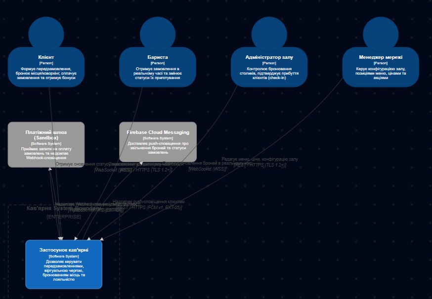
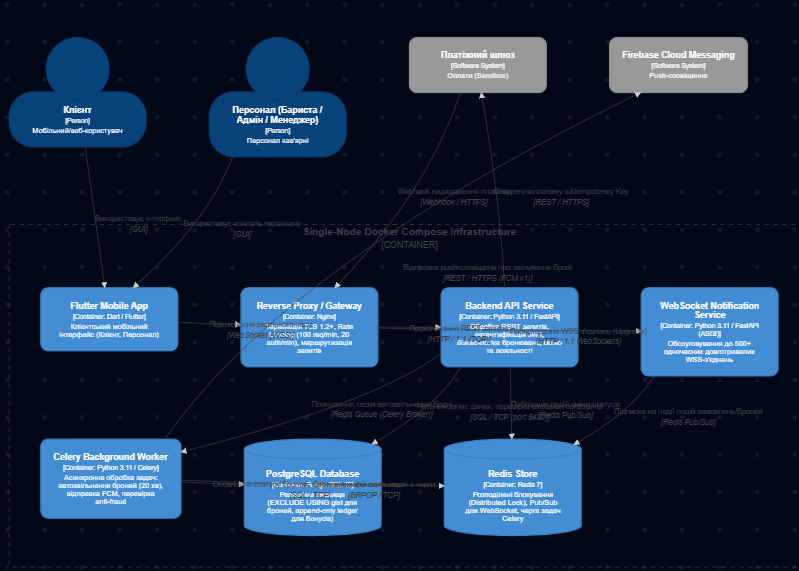
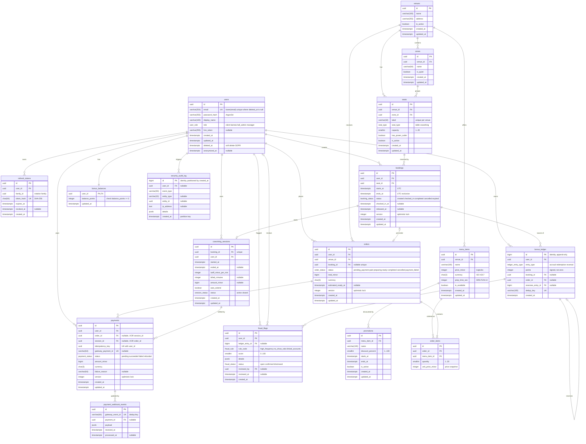
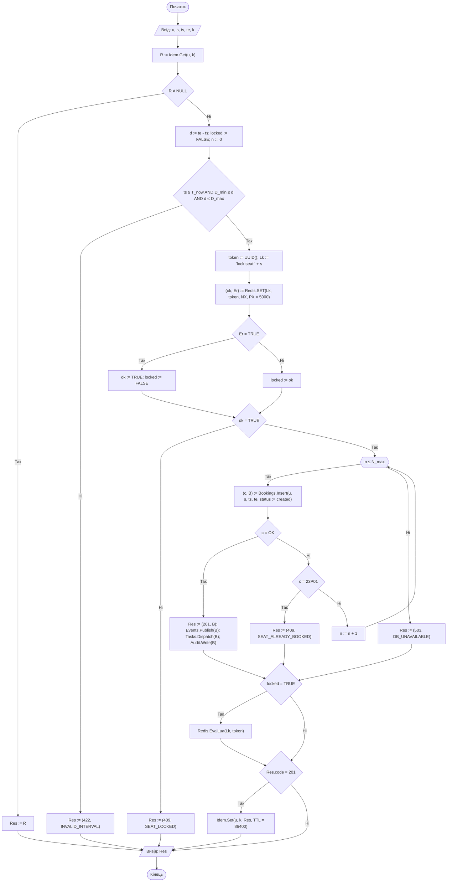
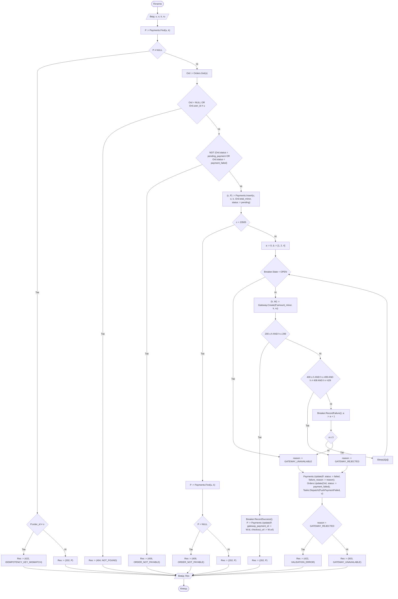
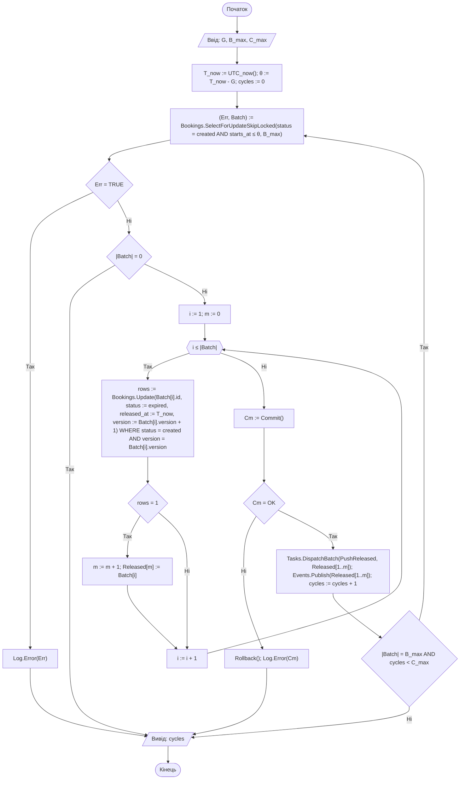

# РОЗДІЛ 2. ПРОЄКТУВАННЯ АРХІТЕКТУРИ

2.1. Контекстне та контейнерне моделювання системи (C4 Model)

Діаграми перших двох рівнів моделі C4 (Саймон Браун) виконано за підходом Diagrams-as-Code (Mermaid.js) на основі специфікації srs.md. Кожна стрілка підписана технічним протоколом; ідентифікатори EXT-01…EXT-05 відповідають розділу 1.3 SRS.

2.1.1. Рівень 1: System Context Diagram



**Актори**

| Актор | Роль у системі | Пов'язані вимоги SRS |            
|---|---|---|
| Клієнт            | 	Формує кошик, оплачує, бронює місце, користується коворкінгом, отримує бонуси та push | 	SRS-FUN-01, 02, 05, 06, 10, 14, 17 |
| Бариста	           | Отримує нові замовлення, змінює статус приготування	                                  | SRS-FUN-08                      |
| Адміністратор залу	 | Переглядає бронювання, підтверджує прибуття	                                          | SRS-FUN-09, 10                  |
| Менеджер мережі	   | Керує меню, цінами, акціями, конфігурацією залу	                                      | SRS-FUN-20, 21                  |

**Зовнішні системи**

|Система	|Призначення	|Інтерфейс|
|---|---|---|
|Платіжний шлюз (sandbox)	|Приймає платіж, повертає статус webhook; дані карток обробляє лише шлюз	|EXT-03, EXT-04|
|Firebase Cloud Messaging	|Доставляє push-сповіщення на пристрої клієнтів	|EXT-05|

**Протоколи**

| Протокол                                   | Напрям                   |Призначення|
|--------------------------------------------|--------------------------|---|
| REST / HTTPS (TLS 1.2+)	                    | Користувачі → система	    |Команди та запити (EXT-01)|
| WebSocket / TLS (WSS)	| Система → користувачі	    | Події реального часу (EXT-02) |
| REST / HTTPS	| Система → платіжний шлюз	 | Створення платежу (EXT-03) |
| Webhook / HTTPS	| Платіжний шлюз → система	 | Статус платежу (EXT-04)  |
| REST / HTTPS (FCM HTTP v1)	| Система → FCM	            | Запит на push (EXT-05)   |
| FCM push / TLS	| FCM → пристрій клієнта	   | Доставка push-сповіщення |

2.1.2. Рівень 2: Container Diagram



**Контейнери**

| Контейнер                                                                                                                                                 | Технологія	                                                                                                                     | Призначення                                                                                                                                 | Вимоги SRS                                                                                                                                |
|-----------------------------------------------------------------------------------------------------------------------------------------------------------|--------------------------------------------------------------------------------------------------------------------------------|---------------------------------------------------------------------------------------------------------------------------------------------|-------------------------------------------------------------------------------------------------------------------------------------------|
| Flutter App	                                                                                                                                               | Dart / Flutter	                                                                                                                 | Виконується на пристрої користувача, поза Docker Compose; інтерфейс клієнта та консоль персоналу	                                            | SRS-FUN-05, 06, 10                                                                                                                        |
| Reverse Proxy	                                                                                                                                             | Nginx	                                                                                                                          | Єдина точка входу, термінація TLS 1.2+, ліміт 20 запитів на хвилину з однієї IP-адреси для кінцевих точок автентифікації	                    | SRS-NFR-SEC-03, SRS-NFR-SEC-05                                                                                                            |
| Backend API	                                                                                                                                               | FastAPI	                                                                                                                        | Бізнес-логіка, перевірка JWT, RBAC, ліміт 100 запитів на хвилину на користувача (лічильники в Redis), ідемпотентність, блокування бронювань	 | SRS-FUN-01…07, 10, 13…17, 19, 20, 21; SRS-NFR-SEC-01, 02, 05; SRS-NFR-REL-04; SRS-NFR-CONS-01, 02                                         |
| WebSocket Service	                                                                                                                                         | FastAPI ASGI	                                                                                                                   | Ізольована доставка подій, щоб довготривалі з'єднання не блокували REST-навантаження	                                                        | SRS-FUN-04, 08, 09; SRS-NFR-PERF-03                                                                                                       |
| Celery Worker	                                                                                                                                             | Celery	                                                                                                                         | Автозвільнення броней, надсилання push, перевірка anti-fraud, повтори викликів зовнішніх систем	                                             | SRS-FUN-11, 12, 15, 18; SRS-NFR-REL-02, 03                                                                                                |
| Celery Beat	                                                                                                                                               | Celery Beat	                                                                                                                    | Планувальник періодичних задач (перевірка непідтверджених бронювань)	                                                                        | SRS-FUN-11; SRS-NFR-REL-03                                                                                                                |
| PostgreSQL	                                                                                                                                                | PostgreSQL 15	                                                                                                                  | Реляційне сховище: ACID, EXCLUDE USING gist, append-only ledger, журнал подій безпеки	                                                       | SRS-FUN-07, 16; SRS-NFR-CONS-01, SEC-07                                                                                                   |
| Redis	                                                                                                                                                     | Redis 7	                                                                                                                        | Distributed Lock, Pub/Sub, брокер Celery, лічильники лімітів	                                                                                | SRS-NFR-CONS-01, PERF-03                                                                                                                  |
| Backup Job + Backup Storage	| pg_dump, WAL archiving	| Щоденна повна резервна копія та архів WAL	| SRS-NFR-REL-05                                                                                                                            |
| Prometheus, Grafana, Jaeger	| Prometheus, Grafana, OpenTelemetry	| Метрики, перевірка доступності /health, панель моніторингу, трейси API → Worker → PostgreSQL| 	                                                                                                           SRS-NFR-OBS-01; SRS-NFR-REL-01 |

**Протоколи взаємодії між контейнерами**

| Взаємодія	                                                          | Протокол                                                  |
|--------------------------------------------------------------------|-----------------------------------------------------------|
| Flutter App → Reverse Proxy	                                        | REST / HTTPS (TLS 1.2+) та WebSocket / TLS (WSS)          |
| Платіжний шлюз → Reverse Proxy	                                     | Webhook / HTTPS                                           |
| FCM → Flutter App	                                                  | FCM push / TLS                                            |
| Reverse Proxy → Backend API,                                       | WebSocket Service	HTTP/1.1 / TCP (внутрішня мережа Docker) |
| Backend API, Celery Worker → PostgreSQL                            | 	SQL / TCP 5432                                            |
| Backend API, WebSocket Service, Celery Worker, Celery Beat → Redis	 | RESP / TCP 6379; Pub/Sub для подій                        |
| Backend API → Платіжний шлюз	                                       | REST / HTTPS з Idempotency-Key                            |
| Celery Worker → FCM	                                                | REST / HTTPS (FCM HTTP v1)                                |
| Backup Job → PostgreSQL	                                            | pg_dump / TCP 5432                                        |
| PostgreSQL, Backup Job → Backup Storage	                            | Файловий I/O (Docker volume)                              |
| Prometheus → API, WebSocket Service, Worker	                        | HTTP / TCP (/metrics)                                     |
| Grafana → Prometheus	                                               | PromQL / HTTP                                             |
| Backend API, Celery Worker → Jaeger	| OTLP / gRPC                                               |

Обмеження, які потрібно зазначити. Nginx обмежує частоту запитів за IP-адресою і не знає ідентифікатора користувача, тому ліміт «на користувача» (SRS-NFR-SEC-05) реалізується в Backend API через лічильники Redis. Окремий Identity Provider та реплікація PostgreSQL не передбачені (SRS, розділ 1.4).

## 2.2. Компонентне моделювання критичного сервісу системи

Для компонентної декомпозиції обрано контейнер **Backend API** (Python 3.11 / FastAPI) з рівня 2. Контейнер містить найскладнішу та критичну для коректності логіку: безконфліктне бронювання місць (блокування Redis і обмеження EXCLUDE у PostgreSQL), перевірку JWT і ролей, ліміт запитів на користувача, ідемпотентність, публікацію подій і постановку фонових задач. Компонентну схему побудовано для підсистеми бронювання (створення бронювання, check-in, скасування); модулі замовлень, коворкінгу та лояльності реалізуються за тим самим шаблоном шарів.

### 2.2.1. Рівень 3: Component Diagram контейнера Backend API

```mermaid
C4Component
    title C4 Level 3 - Component Diagram: Backend API, підсистема бронювання

    Container(reverse_proxy, "Reverse Proxy", "Nginx", "Термінація TLS 1.2+, ліміт запитів за IP, маршрутизація")
    ContainerDb(postgres_db, "PostgreSQL", "PostgreSQL 15", "EXCLUDE USING gist, журнал подій безпеки")
    ContainerDb(redis_store, "Redis", "Redis 7", "Distributed Lock, Pub/Sub, брокер Celery, лічильники лімітів, ключі ідемпотентності")
    Container(jaeger, "Jaeger", "Jaeger + OpenTelemetry", "Зберігання та перегляд трейсів")
    Container(prometheus, "Prometheus", "Prometheus", "Збір метрик")

    Container_Boundary(backend_api, "Backend API (Python 3.11 / FastAPI)") {
        Component(telemetry_mw, "Telemetry Middleware", "OpenTelemetry SDK, prometheus-client", "Трейси, метрики затримки та частки конфліктів, структуроване логування")
        Component(booking_router, "Booking Router", "FastAPI APIRouter", "Inbound-шар: POST /bookings, POST /bookings/id/check-in, DELETE /bookings/id")
        Component(auth_guard, "Auth Guard", "FastAPI Depends, PyJWT", "Верифікація підпису та строку дії JWT, формування claims користувача")
        Component(rbac_policy, "RBAC Policy", "FastAPI Depends", "Deny by default, перевірка ролі та права на ресурс, код 403")
        Component(rate_limiter, "Rate Limiter", "FastAPI Depends, redis-py", "Ліміт 100 запитів на хвилину на користувача, код 429")
        Component(idempotency_guard, "Idempotency Guard", "FastAPI Depends, redis-py", "Дедуплікація за ключем Idempotency-Key у межах користувача, TTL 24 години")
        Component(dto_validation, "DTO Validation", "Pydantic v2", "Схеми запитів і відповідей, код 422")
        Component(error_handler, "Global Error Handler", "FastAPI exception handlers", "Відображення доменних помилок у HTTP-коди 401, 403, 404, 409, 422")
        Component(composition_root, "Composition Root", "FastAPI Depends, провайдери залежностей", "Єдине місце зв'язування портів з адаптерами")
        Component(booking_service, "Booking Service", "Application Service, Python", "Сценарії CreateBooking, CheckIn, CancelBooking; координація портів")
        Component(booking_domain, "Booking Domain", "Python dataclasses", "Агрегат Booking, TimeInterval, BookingStateMachine, правила бронювання")
        Component(seat_lock_port, "SeatLock Port", "Python Protocol", "Інтерфейс блокування місця")
        Component(booking_repo_port, "BookingRepository Port", "Python Protocol", "Інтерфейс збереження бронювань")
        Component(event_port, "EventPublisher Port", "Python Protocol", "Інтерфейс публікації подій")
        Component(task_port, "TaskDispatcher Port", "Python Protocol", "Інтерфейс постановки фонових задач")
        Component(audit_port, "AuditLog Port", "Python Protocol", "Інтерфейс запису подій безпеки")
        Component(redis_seat_lock, "Redis Seat Lock", "redis-py, Lua", "Адаптер: SET NX PX із токеном власника, звільнення Lua-скриптом")
        Component(sql_booking_repo, "SQL Booking Repository", "SQLAlchemy 2.0 async, asyncpg", "Адаптер: INSERT у транзакції, перетворення порушення EXCLUDE на SeatAlreadyBooked")
        Component(redis_event_publisher, "Redis Event Publisher", "redis-py", "Адаптер: публікація подій у канали Pub/Sub")
        Component(celery_dispatcher, "Celery Task Dispatcher", "Celery client", "Адаптер: постановка задач push та перевірок у чергу")
        Component(sql_audit_repo, "SQL Audit Repository", "SQLAlchemy 2.0 async", "Адаптер: запис подій безпеки в окрему таблицю")
    }

    Rel(reverse_proxy, telemetry_mw, "Передача HTTP-запиту", "HTTP/1.1 / TCP, ASGI")
    Rel(telemetry_mw, booking_router, "Передача запиту обробнику", "ASGI middleware chain")

    Rel(booking_router, auth_guard, "Верифікація JWT", "Depends, in-process")
    Rel(booking_router, rbac_policy, "Перевірка ролі та права", "Depends, in-process")
    Rel(booking_router, rate_limiter, "Перевірка ліміту на користувача", "Depends, in-process")
    Rel(booking_router, idempotency_guard, "Перевірка ключа ідемпотентності", "Depends, in-process")
    Rel(booking_router, dto_validation, "Валідація тіла запиту", "Pydantic model, in-process")
    Rel(booking_router, booking_service, "Виклик сценарію використання", "async interface call")
    Rel(booking_router, error_handler, "Передача виключень", "FastAPI exception handlers")

    Rel(rate_limiter, redis_store, "INCR та EXPIRE лічильника", "RESP / TCP 6379")
    Rel(idempotency_guard, redis_store, "SET NX та GET ключа з TTL", "RESP / TCP 6379")

    Rel(composition_root, booking_service, "Впровадження портів", "Dependency Injection")
    Rel(booking_service, booking_domain, "Перевірка інваріантів і переходів станів", "in-process")
    Rel(booking_service, seat_lock_port, "Захоплення та звільнення блокування місця", "Protocol call")
    Rel(booking_service, booking_repo_port, "Збереження бронювання", "Protocol call")
    Rel(booking_service, event_port, "Публікація події бронювання", "Protocol call")
    Rel(booking_service, task_port, "Постановка задач push та перевірок", "Protocol call")
    Rel(booking_service, audit_port, "Запис події безпеки", "Protocol call")

    Rel(redis_seat_lock, seat_lock_port, "Реалізація порту (DIP)", "implements")
    Rel(sql_booking_repo, booking_repo_port, "Реалізація порту (DIP)", "implements")
    Rel(redis_event_publisher, event_port, "Реалізація порту (DIP)", "implements")
    Rel(celery_dispatcher, task_port, "Реалізація порту (DIP)", "implements")
    Rel(sql_audit_repo, audit_port, "Реалізація порту (DIP)", "implements")

    Rel(redis_seat_lock, redis_store, "SET NX PX, Lua-скрипт звільнення", "RESP / TCP 6379")
    Rel(sql_booking_repo, postgres_db, "INSERT з EXCLUDE USING gist", "SQL / TCP 5432")
    Rel(redis_event_publisher, redis_store, "PUBLISH події", "Redis Pub/Sub / TCP 6379")
    Rel(celery_dispatcher, redis_store, "Постановка задач у чергу Celery", "RESP / TCP 6379")
    Rel(sql_audit_repo, postgres_db, "INSERT події безпеки", "SQL / TCP 5432")

    Rel(telemetry_mw, jaeger, "Експорт трейсів", "OTLP / gRPC")
    Rel(prometheus, telemetry_mw, "Збір метрик", "HTTP / TCP, /metrics")

    UpdateLayoutConfig($c4ShapeInRow="4", $c4BoundaryInRow="1")
```



### 2.2.2. Опис компонентів

| Компонент | Шар | Технологія | Призначення та взаємодія |
| :--- | :--- | :--- | :--- |
| Telemetry Middleware | Наскрізний | OpenTelemetry SDK, prometheus-client | Єдина ASGI-обгортка всіх запитів: створює span, вимірює затримку та частку відповідей 409, експортує трейси в Jaeger (OTLP / gRPC), надає /metrics для Prometheus |
| Booking Router | Inbound | FastAPI APIRouter | Приймає REST-запити, підключає залежності в порядку Auth Guard, RBAC Policy, Rate Limiter, DTO Validation, Idempotency Guard і викликає Booking Service. Бізнес-логіки та доступу до БД не містить |
| Auth Guard | Inbound, захист | FastAPI Depends, PyJWT | Перевіряє підпис і строк дії access-токена (до 15 хв); за недійсного токена повертає 401 |
| RBAC Policy | Inbound, захист | FastAPI Depends | Перевіряє роль із claims (клієнт, бариста, адміністратор, менеджер) і право на ресурс за принципом deny by default; повертає 403 |
| Rate Limiter | Inbound, захист | FastAPI Depends, redis-py | Рахує запити користувача в Redis (INCR, EXPIRE); ліміт 100 запитів на хвилину; повертає 429. Ідентифікатор користувача береться з claims, тому залежність виконується після Auth Guard |
| Idempotency Guard | Inbound, надійність | FastAPI Depends, redis-py | Зберігає результат першого виконання за ключем «користувач + маршрут + Idempotency-Key» з TTL 24 години; повторний запит повертає збережену відповідь |
| DTO Validation | Inbound | Pydantic v2 | Перевіряє структуру, типи та межі значень (інтервал часу, ідентифікатор місця); повертає 422 |
| Global Error Handler | Наскрізний | FastAPI exception handlers | Єдина точка відображення доменних виключень (SeatAlreadyBooked, InvalidTransition, NotFound) у HTTP-коди без розкриття внутрішніх деталей |
| Composition Root | Конфігурація | Провайдери залежностей FastAPI | Єдине місце, де порти зв'язуються з конкретними адаптерами; решта компонентів залежить лише від інтерфейсів |
| Booking Service | Application | Python | Реалізує сценарії CreateBooking, CheckIn, CancelBooking: захоплює блокування, звертається до доменної моделі, зберігає бронь, публікує подію, ставить задачі, записує подію безпеки. Залежить лише від портів і домену |
| Booking Domain | Domain | Python dataclasses | Агрегат Booking, значення TimeInterval, автомат станів BookingStateMachine (created, checked_in, completed, cancelled, expired), правила (мінімальна та максимальна тривалість, заборона бронювання в минулому). Не залежить від фреймворків і БД |
| SeatLock Port, BookingRepository Port, EventPublisher Port, TaskDispatcher Port, AuditLog Port | Application (інтерфейси) | Python Protocol | Абстракції, які визначає внутрішнє ядро. Реалізація належить зовнішнім адаптерам, що відповідає принципу інверсії залежностей |
| Redis Seat Lock | Outbound | redis-py, Lua | Реалізує SeatLock Port: SET NX PX із випадковим токеном власника, TTL 5 с, звільнення Lua-скриптом, що перевіряє токен. Протокол RESP / TCP 6379 |
| SQL Booking Repository | Outbound | SQLAlchemy 2.0 async, asyncpg | Реалізує BookingRepository Port: INSERT у транзакції; порушення обмеження EXCLUDE перетворює на SeatAlreadyBooked. Протокол SQL / TCP 5432 |
| Redis Event Publisher | Outbound | redis-py | Реалізує EventPublisher Port: PUBLISH у канали, які слухає контейнер WebSocket Service. Протокол Redis Pub/Sub / TCP 6379 |
| Celery Task Dispatcher | Outbound | Celery client | Реалізує TaskDispatcher Port: ставить задачі push та перевірок у чергу Celery в Redis |
| SQL Audit Repository | Outbound | SQLAlchemy 2.0 async | Реалізує AuditLog Port: запис подій безпеки (створення та скасування бронювання, відмови авторизації) у PostgreSQL |

### 2.2.3. Потік обробки запиту POST /bookings

1. Reverse Proxy передає запит у Backend API (HTTP/1.1); Telemetry Middleware створює span.
2. Booking Router викликає Auth Guard: недійсний токен завершує обробку кодом 401.
3. RBAC Policy перевіряє роль: недостатня роль завершує обробку кодом 403.
4. Rate Limiter збільшує лічильник користувача в Redis: перевищення завершує обробку кодом 429.
5. DTO Validation перевіряє тіло запиту: помилка завершує обробку кодом 422.
6. Idempotency Guard шукає збережений результат за ключем: за збігу повертає його без повторного виконання.
7. Booking Router передає виклик у Booking Service.
8. Booking Service перевіряє правила в Booking Domain.
9. Booking Service через SeatLock Port захоплює блокування місця. Якщо блокування утримує інший запит, повертається помилка конфлікту (код 409). Якщо Redis недоступний, сервіс продовжує без блокування, оскільки цілісність гарантує обмеження EXCLUDE (SRS-NFR-CONS-02).
10. Booking Service через BookingRepository Port виконує INSERT. Порушення EXCLUDE перетворюється на SeatAlreadyBooked і код 409.
11. Після успішного збереження Booking Service публікує подію (EventPublisher Port), ставить задачі (TaskDispatcher Port) і записує подію безпеки (AuditLog Port).
12. Блокування звільняється, Idempotency Guard зберігає результат, Telemetry Middleware закриває span.

### 2.2.4. Відповідність принципам Clean Architecture та SOLID

| Принцип | Як забезпечено на схемі |
| :--- | :--- |
| Правило залежностей (залежності спрямовані до ядра) | Booking Router залежить від Booking Service; Booking Service залежить від Booking Domain і портів; адаптери залежать від портів. Жодний компонент ядра не залежить від адаптера |
| Відсутність обходу шарів | Booking Router не має зв'язків із PostgreSQL або Redis через адаптери бронювання; доступ до даних бронювань можливий лише через Booking Service та BookingRepository Port |
| Інверсія залежностей (DIP) | П'ять портів визначено в ядрі, реалізації (Redis Seat Lock, SQL Booking Repository, Redis Event Publisher, Celery Task Dispatcher, SQL Audit Repository) зв'язано через Composition Root |
| Єдина відповідальність (SRP) | Кожна залежність виконує одну функцію: Auth Guard перевіряє токен, RBAC Policy перевіряє права, Rate Limiter рахує запити, Idempotency Guard дедуплікує |
| Відкритість до розширення (OCP) | Заміна Redis Event Publisher на адаптер Kafka не змінює Booking Service |
| Ізоляція доменного ядра | Booking Domain не імпортує FastAPI, SQLAlchemy та redis-py |
| Єдина обробка помилок | Доменні виключення перетворюються лише в Global Error Handler |
| Безпека | Auth Guard, RBAC Policy, Rate Limiter розташовані до виклику Booking Service |

**Зауваження щодо порядку залежностей.** Ліміт на користувача (SRS-NFR-SEC-05) реалізовано як залежність маршруту після Auth Guard, а не як ASGI middleware, оскільки ідентифікатор користувача відомий лише після верифікації JWT. Ліміт за IP-адресою залишається в Nginx на рівні контейнера Reverse Proxy.

### 2.2.5. Трасування на вимоги SRS

| Вимога SRS | Компонент, що її реалізує |
| :--- | :--- |
| SRS-FUN-06, SRS-FUN-07 | Booking Service, Booking Domain, Redis Seat Lock, SQL Booking Repository |
| SRS-FUN-10 | Booking Router, Booking Service, Booking Domain (BookingStateMachine) |
| SRS-FUN-09, SRS-FUN-13 | Redis Event Publisher, Celery Task Dispatcher |
| SRS-FUN-19 | Auth Guard, RBAC Policy |
| SRS-NFR-CONS-01, SRS-NFR-CONS-02 | Redis Seat Lock, SQL Booking Repository (обмеження EXCLUDE) |
| SRS-NFR-REL-04 | Idempotency Guard |
| SRS-NFR-SEC-01, SRS-NFR-SEC-02 | Auth Guard, RBAC Policy |
| SRS-NFR-SEC-05 | Rate Limiter |
| SRS-NFR-SEC-07 | AuditLog Port, SQL Audit Repository |
| SRS-NFR-PERF-02 | Telemetry Middleware (вимірювання), Redis Seat Lock (скорочення навантаження на БД) |
| SRS-NFR-OBS-01 | Telemetry Middleware |

Ідентифікатори SRS-FUN і SRS-NFR узято з [srs.md](./srs.md); перед фіксацією перевірте відповідність нумерації вашій фінальній версії.

<!-- Додати в кінець docs/2_design.md. Підрозділи 2.1 і 2.2 вже наявні. -->

## 2.3. Архітектурні рішення (ADR)

Рішення про механізм запобігання подвійному бронюванню зафіксовано в [ADR-0001](./adr/0001-choice-of-technology.md) (варіант F: блокування Redis та обмеження EXCLUDE у PostgreSQL). Схема даних підрозділу 2.4 реалізує другий рівень цього захисту (обмеження `bookings_no_overlap`).

## 2.4. Проєктування та моделювання баз даних

Шар збереження даних реалізується в PostgreSQL 15 (контейнер `PostgreSQL` рівня 2 C4); Redis зберігає лише тимчасові дані (блокування, ключі ідемпотентності на 24 години, лічильники лімітів, Pub/Sub) і схемою нижче не охоплюється. Вимоги-джерела: [SRS-FUN-05…07, 10, 11, 13…18, 20, 21](./srs.md), [SRS-NFR-CONS-01, 02](./srs.md), [SRS-NFR-SEC-06, 07](./srs.md).

### 2.4.1. Діаграма сутність-зв'язок (ERD)



Умовні позначення: `PK` первинний ключ, `FK` зовнішній ключ, `UK` унікальний ключ; кратність за нотацією Crow's Foot. У іменах типів Mermaid дужки `varchar(n)` задають довжину.

### 2.4.2. Типи, перерахування та загальні правила

| Правило | Рішення | Обґрунтування |
| :--- | :--- | :--- |
| Ідентифікатори | `uuid` (`gen_random_uuid()`), 16 байт; для журналів з лише додаванням записів `bigint GENERATED ALWAYS AS IDENTITY` | UUID не розкриває кількість записів і генерується на стороні застосунку; послідовний bigint зберігає порядок у журналах |
| Час | `timestamptz`, значення в UTC | SRS 1.1: усі часові значення зберігаються в UTC; тип необхідний для `tstzrange` в EXCLUDE |
| Гроші | `integer` / `bigint` у мінімальних одиницях (`*_minor`) та `char(3)` за ISO 4217 | Виключає похибки `float`; відповідає `*_minor` у [openapi.yaml](./api/openapi.yaml) |
| Статуси | PostgreSQL `ENUM`: `user_role`, `seat_type`, `booking_status`, `order_status`, `payment_status`, `session_status`, `ledger_entry_type`, `fraud_rule`, `fraud_status` | Значення збігаються з enum у OpenAPI (перевірено в 2.7) |
| Оптимістичне блокування | Поле `version integer NOT NULL DEFAULT 1` у `bookings`, `orders`, `payments` | Виявлення конкурентних змін без утримання блокування рядка |
| Службові поля | `created_at`, `updated_at` (тригер `set_updated_at`) у змінюваних таблицях | Аудит змін |
| Видалення | М'яке (`deleted_at`) та знеособлення (`anonymized_at`) лише в `users`; інші таблиці без фізичного видалення бізнес-даних | SRS-NFR-SEC-06: видалення або знеособлення протягом 30 днів |
| Дані карток | Відсутні в схемі | SRS-NFR-SEC-06; картки обробляє лише платіжний шлюз |

Значення перерахувань:

| Тип | Значення |
| :--- | :--- |
| `user_role` | `client`, `barista`, `hall_admin`, `manager` |
| `seat_type` | `table`, `coworking` |
| `booking_status` | `created`, `checked_in`, `completed`, `cancelled`, `expired` |
| `order_status` | `pending_payment`, `paid`, `preparing`, `ready`, `completed`, `cancelled`, `payment_failed` |
| `payment_status` | `pending`, `succeeded`, `failed`, `refunded` |
| `session_status` | `active`, `closed` |
| `ledger_entry_type` | `accrual`, `redemption`, `reversal` |
| `fraud_rule` | `high_frequency`, `no_show_ratio`, `linked_accounts` |
| `fraud_status` | `open`, `confirmed`, `dismissed` |

### 2.4.3. Специфікація таблиць

Усі поля `NOT NULL`, якщо не зазначено `NULL`.

**users** (SRS-FUN-19, SRS-NFR-SEC-01, 06)

| Поле | Тип | Обмеження | Опис |
| :--- | :--- | :--- | :--- |
| id | uuid | PK | Ідентифікатор користувача |
| email | varchar(254) | UNIQUE за `lower(email)` серед `deleted_at IS NULL` | Логін |
| password_hash | varchar(255) | | Хеш Argon2id |
| display_name | varchar(100) | | Відображуване ім'я |
| role | user_role | DEFAULT `client` | Роль RBAC |
| fcm_token | varchar(255) | NULL | Токен пристрою для push (EXT-05) |
| created_at, updated_at | timestamptz | DEFAULT `now()` | Службові поля |
| deleted_at | timestamptz | NULL | Момент запиту на видалення |
| anonymized_at | timestamptz | NULL | Момент знеособлення; після нього `email`, `display_name`, `fcm_token` перезаписані |

**refresh_tokens** (SRS-NFR-SEC-01: ротація)

| Поле | Тип | Обмеження | Опис |
| :--- | :--- | :--- | :--- |
| id | uuid | PK | |
| user_id | uuid | FK users(id) ON DELETE CASCADE | Власник |
| family_id | uuid | | Сім'я токенів однієї сесії входу |
| token_hash | char(64) | UNIQUE | SHA-256 токена; сам токен не зберігається |
| expires_at | timestamptz | | Строк дії |
| revoked_at | timestamptz | NULL | Ненульове значення: токен використано або відкликано |
| created_at | timestamptz | DEFAULT `now()` | |

**venues**, **zones**, **seats** (SRS-FUN-05, 21)

| Таблиця.поле | Тип | Обмеження | Опис |
| :--- | :--- | :--- | :--- |
| venues.id | uuid | PK | Заклад мережі |
| venues.name, venues.address | varchar(100), varchar(255) | | Назва та адреса |
| venues.is_active | boolean | DEFAULT `true` | |
| zones.id | uuid | PK | Зона залу |
| zones.venue_id | uuid | FK venues(id) | |
| zones.name | varchar(64) | UNIQUE (venue_id, name) | |
| zones.is_quiet | boolean | DEFAULT `false` | Ознака тихої зони |
| seats.id | uuid | PK | Місце (столик або коворкінг-місце) |
| seats.venue_id, seats.zone_id | uuid | FK venues(id), FK zones(id) | Заклад і зона |
| seats.label | varchar(32) | UNIQUE (venue_id, label) | Позначення на карті залу |
| seats.seat_type | seat_type | | Тип місця |
| seats.capacity | smallint | CHECK `capacity BETWEEN 1 AND 20` | Місткість |
| seats.has_power_outlet | boolean | DEFAULT `false` | Наявність розетки |
| seats.is_active | boolean | DEFAULT `true` | Місце доступне для бронювання |
| created_at, updated_at | timestamptz | | У кожній з трьох таблиць |

**menu_items**, **promotions** (SRS-FUN-01, 20)

| Таблиця.поле | Тип | Обмеження | Опис |
| :--- | :--- | :--- | :--- |
| menu_items.id | uuid | PK | Позиція меню |
| menu_items.venue_id | uuid | FK venues(id) | |
| menu_items.name | varchar(100) | | |
| menu_items.price_minor | integer | CHECK `price_minor >= 0` | Базова ціна |
| menu_items.currency | char(3) | DEFAULT `'UAH'` | |
| menu_items.prep_time_sec | integer | CHECK `prep_time_sec >= 0` | Тривалість приготування для SRS-FUN-13 |
| menu_items.is_available | boolean | DEFAULT `true` | Недоступна позиція відхиляється (SRS-FUN-01) |
| promotions.id | uuid | PK | Акція |
| promotions.menu_item_id | uuid | FK menu_items(id) | |
| promotions.name | varchar(100) | | |
| promotions.discount_percent | smallint | CHECK `discount_percent BETWEEN 1 AND 100` | Знижка |
| promotions.starts_at, promotions.ends_at | timestamptz | CHECK `ends_at > starts_at` | Період дії |
| promotions.is_active | boolean | DEFAULT `true` | |

**bookings** (SRS-FUN-06, 07, 10, 11; SRS-NFR-CONS-01, 02)

| Поле | Тип | Обмеження | Опис |
| :--- | :--- | :--- | :--- |
| id | uuid | PK | |
| user_id | uuid | FK users(id) | Автор бронювання |
| seat_id | uuid | FK seats(id) | Місце |
| starts_at | timestamptz | | Початок інтервалу |
| ends_at | timestamptz | CHECK `ends_at > starts_at` | Виключна межа інтервалу `[starts_at, ends_at)` |
| status | booking_status | DEFAULT `created` | Стан автомата `BookingStateMachine` |
| checked_in_at | timestamptz | NULL | Момент check-in |
| released_at | timestamptz | NULL | Момент автозвільнення (`expired`) |
| version | integer | DEFAULT 1 | Оптимістичне блокування |
| created_at, updated_at | timestamptz | | |

Обмеження цілісності (ADR-0001):

```sql
CREATE EXTENSION IF NOT EXISTS btree_gist;

ALTER TABLE bookings
    ADD CONSTRAINT bookings_no_overlap
    EXCLUDE USING gist (
        seat_id WITH =,
        tstzrange(starts_at, ends_at, '[)') WITH &&
    )
    WHERE (status IN ('created', 'checked_in'));
```

**orders**, **order_items** (SRS-FUN-01, 03, 13)

| Таблиця.поле | Тип | Обмеження | Опис |
| :--- | :--- | :--- | :--- |
| orders.id | uuid | PK | |
| orders.user_id, orders.venue_id | uuid | FK users(id), FK venues(id) | |
| orders.booking_id | uuid | NULL, FK bookings(id), UNIQUE | Зв'язок із бронюванням (передзамовлення під бронь) |
| orders.status | order_status | DEFAULT `pending_payment` | |
| orders.total_minor | bigint | CHECK `total_minor >= 0` | Сума, обчислена сервером як сума `quantity * unit_price_minor` |
| orders.currency | char(3) | | |
| orders.estimated_ready_at | timestamptz | NULL | Орієнтовний час готовності (SRS-FUN-03) |
| orders.version | integer | DEFAULT 1 | |
| order_items.id | uuid | PK | |
| order_items.order_id | uuid | FK orders(id) ON DELETE CASCADE | |
| order_items.menu_item_id | uuid | FK menu_items(id) | |
| order_items.quantity | smallint | CHECK `quantity BETWEEN 1 AND 20` | |
| order_items.unit_price_minor | integer | CHECK `unit_price_minor >= 0` | Знімок ціни з урахуванням акції; навмисна денормалізація, бо `menu_items.price_minor` змінюється в часі |

**payments**, **payment_webhook_events** (SRS-FUN-02, SRS-NFR-REL-02, 04)

| Таблиця.поле | Тип | Обмеження | Опис |
| :--- | :--- | :--- | :--- |
| payments.id | uuid | PK | |
| payments.user_id | uuid | FK users(id) | |
| payments.order_id | uuid | NULL, FK orders(id) | Платіж за замовлення |
| payments.session_id | uuid | NULL, FK coworking_sessions(id) | Платіж за коворкінг-сесію; CHECK `num_nonnulls(order_id, session_id) = 1` |
| payments.idempotency_key | uuid | UNIQUE (user_id, idempotency_key) | Ключ `Idempotency-Key`; зберігається довше за 24 години TTL у Redis |
| payments.gateway_payment_id | varchar(64) | NULL, UNIQUE | Ідентифікатор платежу у шлюзі |
| payments.status | payment_status | DEFAULT `pending` | |
| payments.amount_minor | bigint | CHECK `amount_minor > 0` | |
| payments.currency | char(3) | | |
| payments.failure_reason | varchar(64) | NULL | `GATEWAY_UNAVAILABLE`, `GATEWAY_REJECTED` |
| payments.version | integer | DEFAULT 1 | |
| payment_webhook_events.id | uuid | PK | |
| payment_webhook_events.gateway_event_id | varchar(64) | UNIQUE | Ключ дедуплікації подій EXT-04 |
| payment_webhook_events.payment_id | uuid | NULL, FK payments(id) | |
| payment_webhook_events.payload | jsonb | | Сире тіло події |
| payment_webhook_events.received_at | timestamptz | DEFAULT `now()` | |
| payment_webhook_events.processed_at | timestamptz | NULL | |

**coworking_sessions** (SRS-FUN-14, 15)

| Поле | Тип | Обмеження | Опис |
| :--- | :--- | :--- | :--- |
| id | uuid | PK | |
| booking_id | uuid | FK bookings(id), UNIQUE | Одна сесія на бронювання |
| user_id | uuid | FK users(id) | |
| started_at | timestamptz | | |
| ended_at | timestamptz | NULL | |
| tariff_minor_per_min | integer | CHECK `> 0` | Тариф за хвилину |
| billed_minutes | integer | NULL | Кількість розпочатих хвилин |
| amount_minor | bigint | NULL | `tariff_minor_per_min * billed_minutes` |
| auto_extend | boolean | DEFAULT `false` | Автоматичне продовження |
| status | session_status | DEFAULT `active` | |
| created_at, updated_at | timestamptz | | |

**bonus_ledger**, **bonus_balances** (SRS-FUN-16, 17)

| Таблиця.поле | Тип | Обмеження | Опис |
| :--- | :--- | :--- | :--- |
| bonus_ledger.id | bigint | PK, IDENTITY | |
| bonus_ledger.user_id | uuid | FK users(id) | |
| bonus_ledger.entry_type | ledger_entry_type | | Нарахування, списання, сторно |
| bonus_ledger.points | integer | CHECK `points <> 0` | Знакове значення |
| bonus_ledger.booking_id, order_id | uuid | NULL, FK | Джерело операції |
| bonus_ledger.reverses_entry_id | bigint | NULL, FK bonus_ledger(id) | Запис, який сторнується |
| bonus_ledger.dedup_key | varchar(100) | UNIQUE | Наприклад `accrual:booking:<id>`; виключає подвійне нарахування |
| bonus_ledger.created_at | timestamptz | DEFAULT `now()` | |
| bonus_balances.user_id | uuid | PK, FK users(id) | |
| bonus_balances.balance_points | integer | CHECK `balance_points >= 0` | Похідне значення; оновлюється тригером AFTER INSERT на `bonus_ledger` у тій самій транзакції |
| bonus_balances.updated_at | timestamptz | | |

Незмінність журналу: `REVOKE UPDATE, DELETE, TRUNCATE ON bonus_ledger FROM app_role;` та тригер `BEFORE UPDATE OR DELETE`, що викликає виключення.

**fraud_flags**, **security_audit_log** (SRS-FUN-18, SRS-NFR-SEC-07)

| Таблиця.поле | Тип | Обмеження | Опис |
| :--- | :--- | :--- | :--- |
| fraud_flags.id | uuid | PK | |
| fraud_flags.user_id | uuid | FK users(id) | Користувач, якому належить позначка |
| fraud_flags.ledger_entry_id | bigint | NULL, FK bonus_ledger(id) | Підозрілий запис |
| fraud_flags.rule_code | fraud_rule | | Спрацьоване правило |
| fraud_flags.score | smallint | CHECK `score BETWEEN 0 AND 100` | Оцінка ризику |
| fraud_flags.details | jsonb | | Значення метрик, що спричинили спрацювання |
| fraud_flags.status | fraud_status | DEFAULT `open` | |
| fraud_flags.reviewed_by | uuid | NULL, FK users(id) | Хто переглянув |
| fraud_flags.reviewed_at, created_at | timestamptz | | |
| security_audit_log.id | bigint | PK разом із `created_at`, IDENTITY | |
| security_audit_log.user_id | uuid | NULL, FK users(id) ON DELETE SET NULL | |
| security_audit_log.event_type | varchar(50) | | `login`, `role_change`, `booking_cancel`, `auth_denied` |
| security_audit_log.entity_type, entity_id | varchar(32), uuid | NULL | Об'єкт події |
| security_audit_log.ip_address | inet | NULL | |
| security_audit_log.details | jsonb | | Контекст події |
| security_audit_log.created_at | timestamptz | DEFAULT `now()` | Ключ партиціювання `RANGE (created_at)`, секції по місяцях; секції старші за 90 днів видаляються через `DROP PARTITION` |

### 2.4.4. План індексування

| Таблиця | Індекс | Тип | Запит або вимога, яку обслуговує |
| :--- | :--- | :--- | :--- |
| bookings | `bookings_no_overlap` на `(seat_id WITH =, tstzrange(starts_at, ends_at, '[)') WITH &&) WHERE status IN ('created','checked_in')` | GiST (EXCLUDE) | SRS-FUN-07, SRS-NFR-CONS-01; також запит стану місць на інтервал для карти залу (SRS-FUN-05) із тим самим предикатом |
| bookings | `ix_bookings_user_start (user_id, starts_at DESC)` | B-tree | Список бронювань користувача |
| bookings | `ix_bookings_created_start (starts_at) WHERE status = 'created'` | B-tree, частковий | Вибірка алгоритму автозвільнення (2.6.3), SRS-NFR-REL-03 |
| users | `uq_users_email_active (lower(email)) WHERE deleted_at IS NULL` | B-tree, унікальний | Вхід за email |
| refresh_tokens | `token_hash` UNIQUE; `(user_id) WHERE revoked_at IS NULL`; `(family_id)` | B-tree | Ротація та відкликання сім'ї токенів |
| seats | `(venue_id, label)` UNIQUE; `(venue_id) WHERE is_active` | B-tree | Карта залу, p95 не більше 200 мс (SRS-NFR-PERF-01) |
| menu_items | `(venue_id) WHERE is_available` | B-tree, частковий | Меню |
| promotions | `(menu_item_id, starts_at, ends_at) WHERE is_active` | B-tree, частковий | Пошук чинної акції під час формування кошика |
| orders | `(venue_id, status, created_at) WHERE status IN ('paid','preparing','ready')` | B-tree, частковий | Черга замовлень закладу (SRS-FUN-03, 08) |
| orders | `(user_id, created_at DESC)`; `(booking_id) UNIQUE WHERE booking_id IS NOT NULL` | B-tree | Історія замовлень; зв'язок із бронюванням |
| order_items | `(order_id)` | B-tree | Позиції замовлення |
| payments | `(user_id, idempotency_key)` UNIQUE | B-tree | SRS-NFR-REL-04 |
| payments | `uq_payments_order_active (order_id) UNIQUE WHERE order_id IS NOT NULL AND status IN ('pending','succeeded')` | B-tree, частковий унікальний | Заборона другого активного платежу за одне замовлення за іншого ключа ідемпотентності |
| payments | `(gateway_payment_id) UNIQUE WHERE gateway_payment_id IS NOT NULL` | B-tree | Зіставлення webhook |
| payment_webhook_events | `(gateway_event_id)` UNIQUE | B-tree | Дедуплікація повторної доставки |
| coworking_sessions | `(booking_id)` UNIQUE; `(user_id) WHERE status = 'active'` | B-tree | Активні сесії |
| bonus_ledger | `(user_id, created_at DESC)`; `(dedup_key)` UNIQUE; `(reverses_entry_id) WHERE reverses_entry_id IS NOT NULL` | B-tree | Баланс, антифрод, виключення дублів |
| fraud_flags | `(created_at) WHERE status = 'open'`; `(user_id)` | B-tree, частковий | Черга перегляду |
| security_audit_log | `(user_id, created_at DESC)` на кожній секції | B-tree | Пошук подій користувача; відсікання секцій за `created_at` |

Індекси GIN для `jsonb` (`payload`, `details`) не створюються: пошук за вмістом `jsonb` у сценаріях SRS не передбачено. Векторні індекси (HNSW, IVF) не застосовуються: сховище ембеддінгів у системі відсутнє. GiST-індекс `bookings_no_overlap` збільшує вартість запису; вплив на SRS-NFR-PERF-02 підлягає вимірюванню в Розділі 3 (ADR-0001).

### 2.4.5. Нормалізація та навмисна денормалізація

Схема відповідає 3NF: транзитивні залежності неключових атрибутів відсутні; довідники (`venues`, `zones`, `seats`, `menu_items`) винесено в окремі таблиці. Навмисні відхилення:

| Поле | Причина | Контроль узгодженості |
| :--- | :--- | :--- |
| `order_items.unit_price_minor` | Знімок ціни на момент замовлення | Записується одноразово під час створення замовлення |
| `orders.total_minor` | Уникнення агрегації під час оплати | Обчислюється сервером у тій самій транзакції, що й `order_items` |
| `bonus_balances.balance_points` | Швидке читання балансу | Тригер AFTER INSERT на `bonus_ledger`; звірка сумою журналу в тесті SRS-FUN-16 |

## 2.5. Специфікація міжсервісних контрактів (API Contracts)

Контракт [openapi.yaml](./api/openapi.yaml) (OpenAPI 3.0.3) описує два інтерфейси рівня C4 Container: EXT-01 `Flutter App -> Reverse Proxy -> Backend API` (REST / HTTPS) та EXT-04 `Платіжний шлюз -> Reverse Proxy -> Backend API` (webhook / HTTPS). Контракт придатний для генерації серверних стабів і клієнтських SDK (поле `operationId` унікальне для кожної з 11 операцій).

| Операція | Метод і шлях | Ролі | Успіх | Помилки | SRS |
| :--- | :--- | :--- | :--- | :--- | :--- |
| login | POST `/auth/login` | без токена | 200 | 401, 422, 429, 500 | SRS-FUN-19, SRS-NFR-SEC-01 |
| refreshToken | POST `/auth/refresh` | без токена | 200 | 401, 422, 429, 500 | SRS-NFR-SEC-01 |
| listSeatAvailability | GET `/venues/{venueId}/seats` | усі ролі | 200 | 401, 403, 404, 422, 429, 500 | SRS-FUN-05 |
| createBooking | POST `/bookings` | client | 201 | 401, 403, 409, 422, 429, 500, 503 | SRS-FUN-06, 07; SRS-NFR-CONS-01, 02 |
| getBooking | GET `/bookings/{bookingId}` | client (власник), hall_admin | 200 | 401, 403, 404, 429, 500 | SRS-FUN-06 |
| cancelBooking | DELETE `/bookings/{bookingId}` | client (власник), hall_admin | 204 | 401, 403, 404, 409, 429, 500 | SRS-NFR-SEC-07 |
| checkInBooking | POST `/bookings/{bookingId}/check-in` | client, hall_admin | 200 | 401, 403, 404, 409, 429, 500 | SRS-FUN-10 |
| createOrder | POST `/orders` | client | 201 | 401, 403, 404, 422, 429, 500 | SRS-FUN-01, 13 |
| createPayment | POST `/orders/{orderId}/payments` | client | 202 | 401, 403, 404, 409, 422, 429, 500, 503 | SRS-FUN-02; SRS-NFR-REL-02, 04 |
| handlePaymentWebhook | POST `/payments/webhook` | підпис шлюзу | 204 | 401, 422, 500 | SRS-FUN-02 |
| getBonusBalance | GET `/users/me/bonus-balance` | client | 200 | 401, 403, 429, 500 | SRS-FUN-16, 17 |

Безпека: схема `bearerAuth` (HTTP Bearer, JWT, access-токен до 15 хв) діє глобально; `/auth/*` перевизначають `security: []`; webhook використовує схему `gatewaySignature` (HMAC-SHA256 тіла в заголовку `X-Gateway-Signature`). Ролі кожної операції зафіксовано розширенням `x-required-roles`; доступ до чужого ресурсу повертає 404, відсутність ролі повертає 403 (SRS-NFR-SEC-02).

Обробка помилок: усі відповіді 4xx/5xx мають тип `application/problem+json` (RFC 9457) зі схемою `ProblemDetails` і полем `code` зі словника `ErrorCode`. Для 409 визначено різні коди: `SEAT_LOCKED` (відмова блокування Redis, без звернення до БД), `SEAT_ALREADY_BOOKED` (SQLSTATE 23P01), `INVALID_STATE_TRANSITION`, `ORDER_NOT_PAYABLE`. Відповіді 429 і 503 містять заголовок `Retry-After`.

Ідемпотентність: заголовок `Idempotency-Key` (UUID) обов'язковий для `createBooking`, `createOrder`, `createPayment`; відтворена відповідь позначається заголовком `Idempotency-Replayed: true`; повторне використання ключа з іншим тілом або іншим замовленням завершується кодом 422 (`IDEMPOTENCY_KEY_MISMATCH` в алгоритмі 2.6.2).

## 2.6. Моделювання логіки критичних вузлів системи

Обрано три алгоритми, у яких сконцентровано координаційну складність і вимоги до коректності: створення бронювання (2.6.1, SRS-FUN-06, 07, SRS-NFR-CONS-01, 02), ініціація платежу (2.6.2, SRS-FUN-02, SRS-NFR-REL-02, 04) та автозвільнення бронювань (2.6.3, SRS-FUN-11, 12, SRS-NFR-REL-03). Нотація: `:=` присвоювання; `=`, `≠`, `≤`, `≥` порівняння; `AND`, `OR`, `NOT` логічні зв'язки; `X[i]` елемент масиву; блоки за ДСТУ ISO 5807: термінатор, процес, рішення, дані (ввід/вивід), шестикутник як заголовок циклу.

Припущення, що потребують підтвердження в SRS або ADR: `D_min = 30 хв`, `D_max = 240 хв` (тривалість бронювання, SRS-FUN-06); `N_max = 2` (додаткові спроби транзакції); `B_max = 100`, `C_max = 50` (розмір пакета та ліміт циклів завдання автозвільнення); `G` у діапазоні 20-30 хв (SRS-FUN-11); період Celery Beat 30 с (забезпечує відхилення не більше 60 с за SRS-NFR-REL-03).

### 2.6.1. Алгоритм CreateBooking

Вхід: `u` (user_id), `s` (seat_id), `ts`, `te` (межі інтервалу `[ts, te)`), `k` (Idempotency-Key). Вихід: `Res` = (код, тіло). Змінні: `Lk` ключ блокування, `token` токен власника блокування, `Er` ознака помилки Redis, `ok` результат `SET NX`, `locked` ознака утримання блокування, `c` код результату `INSERT`, `n` лічильник спроб.



Покрокова логіка: (1) `R := Idem.Get(u, k)`; за `R ≠ NULL` повернути `Res := R`. (2) Перевірити `ts ≥ T_now AND D_min ≤ d AND d ≤ D_max`, де `d := te - ts`; інакше `Res := (422, INVALID_INTERVAL)`. (3) Виконати `SET Lk token NX PX 5000`; за `Er = TRUE` продовжити без блокування (`ok := TRUE`, `locked := FALSE`), оскільки коректність забезпечує EXCLUDE (SRS-NFR-CONS-02). (4) За `ok = FALSE` повернути `Res := (409, SEAT_LOCKED)` без звернення до БД. (5) Виконати `INSERT`: за `c = OK` сформувати `Res := (201, B)`, опублікувати подію, поставити задачі, записати подію безпеки; за `c = 23P01` повернути `(409, SEAT_ALREADY_BOOKED)`; за іншого `c` збільшити `n` і повторити, поки `n ≤ N_max`, інакше `(503, DB_UNAVAILABLE)`. (6) За `locked = TRUE` звільнити блокування Lua-скриптом (видалення лише за збігу `token`). (7) За `Res.code = 201` зберегти `Res` в Idempotency Guard з TTL 86400 с.

| Крайова умова | Поведінка |
| :--- | :--- |
| Redis недоступний | Блокування пропускається, захист переходить до EXCLUDE; частка конфліктів фіксується метрикою |
| TTL блокування (5 с) завершився під час транзакції | Інший запит отримує блокування, але EXCLUDE повертає 23P01, подвійного бронювання немає |
| Тимчасова помилка БД | Не більше `N_max + 1` спроб, далі 503; нескінченного циклу немає |
| Збій публікації події або постановки задачі після `INSERT` | Бронювання зберігається; сповіщення та автозвільнення відновлюються завданням 2.6.3 |
| Повторний запит із тим самим `k` | Повертається збережений `Res` без повторного `INSERT` |

### 2.6.2. Алгоритм ProcessPayment

Вхід: `u`, `o` (order_id), `k` (Idempotency-Key), `ru` (return_url). Вихід: `Res`. Змінні: `P` платіж, `Ord` замовлення, `h` HTTP-код шлюзу, `W` відповідь шлюзу, `a` лічильник повторів, `Δ` масив затримок у секундах, `reason` причина відмови, `c` код результату `INSERT`.



Покрокова логіка: (1) `P := Payments.Find(u, k)`; за `P ≠ NULL` і `P.order_id ≠ o` повернути `(422, IDEMPOTENCY_KEY_MISMATCH)`, інакше `(202, P)`. (2) `Ord := Orders.Get(o)`; за `Ord = NULL OR Ord.user_id ≠ u` повернути `(404, NOT_FOUND)`. (3) За `NOT (Ord.status = pending_payment OR Ord.status = payment_failed)` повернути `(409, ORDER_NOT_PAYABLE)`. (4) Створити запис платежу зі статусом `pending`; за `c = 23505` (змагання з паралельним запитом) повторно знайти `P`: якщо `P = NULL`, активний платіж за іншим ключем існує, повернути `(409, ORDER_NOT_PAYABLE)`. (5) Цикл: за `Breaker.State = OPEN` перейти до компенсації з `reason := GATEWAY_UNAVAILABLE`; виконати `Gateway.Create`; за `200 ≤ h AND h ≤ 299` скинути лічильник Circuit Breaker, зберегти `gateway_payment_id` і `checkout_url`, повернути `(202, P)`; за кодом `4xx`, окрім 408 і 429, перейти до компенсації з `reason := GATEWAY_REJECTED`; інакше `Breaker.RecordFailure()`, `a := a + 1` і, за `a ≤ 3`, пауза `Δ[a]` (1, 2, 4 с) та нова спроба. (6) Компенсація: `P.status := failed`, `Ord.status := payment_failed`, push про невдалу оплату; повернути `(422, VALIDATION_ERROR)` для `GATEWAY_REJECTED` або `(503, GATEWAY_UNAVAILABLE)`. Остаточний статус успішного платежу встановлює обробник webhook EXT-04, ідемпотентний за `payment_webhook_events.gateway_event_id`.

| Крайова умова | Поведінка |
| :--- | :--- |
| Повторний запит із тим самим `k` | Повертається `(202, P)` без другого виклику шлюзу (SRS-NFR-REL-04) |
| Другий платіж за те саме замовлення з іншим `k` | Відхиляється часткове унікальне обмеження `uq_payments_order_active` (23505), відповідь 409 |
| Шлюз повертає 5xx, 408, 429 або перевищено час очікування | До 3 повторів із затримками 1, 2, 4 с; нескінченного циклу немає (`a ≤ 3`) |
| 5 послідовних помилок | Circuit Breaker відкривається на 30 с, наступні спроби завершуються без виклику шлюзу |
| Відмова шлюзу | Компенсація: платіж `failed`, замовлення `payment_failed`; повторна оплата дозволена з новим `k` |

### 2.6.3. Алгоритм AutoReleaseExpiredBookings

Вхід (з конфігурації): `G` (інтервал очікування check-in, хв), `B_max` (розмір пакета), `C_max` (максимум пакетів за запуск). Вихід: `cycles` (кількість оброблених пакетів). Завдання запускається Celery Beat з періодом 30 с. Змінні: `θ` порогове значення часу початку, `Batch` вибраний пакет, `Released` масив звільнених бронювань, `rows` кількість оновлених рядків, `Cm` результат фіксації транзакції.



Покрокова логіка: (1) `θ := T_now - G`. (2) Вибрати до `B_max` бронювань `status = created AND starts_at ≤ θ` із `FOR UPDATE SKIP LOCKED`; за помилкою БД записати її в журнал і завершити (наступний запуск через 30 с). (3) Для `i := 1 … |Batch|` виконати `UPDATE … SET status := expired` з умовою `status = created AND version = Batch[i].version`; за `rows = 1` додати `Batch[i]` до `Released`. (4) Зафіксувати транзакцію; за невдачі виконати відкат. (5) Після фіксації поставити push-задачі й опублікувати події для `Released[1..m]` (SRS-FUN-12). (6) Повторити з кроку 2, якщо `|Batch| = B_max AND cycles < C_max`.

| Крайова умова | Поведінка |
| :--- | :--- |
| Порожня вибірка | Завершення без побічних ефектів |
| Одночасний check-in | Оновлення з умовою `status = created AND version = …` повертає `rows = 0`, бронювання пропускається |
| Паралельні екземпляри завдання | `SKIP LOCKED` виключає повторну обробку одного рядка |
| Збій фіксації транзакції | Відкат; push не надсилаються; бронювання буде вибрано наступним запуском |
| Великий обсяг прострочених бронювань | Не більше `C_max` пакетів по `B_max` за запуск; залишок обробляється наступним запуском |
| Збій FCM | Повтори з Circuit Breaker у Celery Worker (SRS-NFR-REL-02); стан бронювання не змінюється |

## 2.7. Інтеграційний аудит та верифікація цілісності доменів

### 2.7.1. Методика

Перехресний аудит виконано над артефактами: схема даних (2.4), контракт [openapi.yaml](./api/openapi.yaml) (2.5), алгоритми (2.6), [srs.md](./srs.md), [ADR-0001](./adr/0001-choice-of-technology.md) та [2_design.md](./2_design.md). Використано: (а) скрипт перехресної перевірки (порівняння перерахувань між ERD та OpenAPI, перевірка наявності всіх `$ref`, унікальності `operationId`, існування ідентифікаторів SRS, на які посилається документація); (б) інженерне рев'ю за промптом ШІ-Аудитора інтеграційної цілісності (протокол в AI Insights).

### 2.7.2. Виявлені розбіжності та їх усунення

| № | Тип | Розбіжність | Усунення | Статус |
| :-: | :--- | :--- | :--- | :-: |
| 1 | Трасування | У `2_design.md` (таблиця контейнерів) є посилання на відсутні в `srs.md` вимоги SRS-FUN-22, SRS-FUN-23, SRS-FUN-24, SRS-NFR-REL-06, SRS-NFR-SEC-12, SRS-NFR-OBS-02 | Посилання замінено на наявні вимоги (команди в додатку Git-інструкції) | Усунено |
| 2 | Посилання | Кінцеве посилання `../srs.md` у `2_design.md` веде за межі `docs/`; посилання `2_1_c4_context_container.md` не відповідає наявному файлу | Замінено на `./srs.md`; посилання на розділ 2.1.2 замінено текстовою вказівкою номера підрозділу | Усунено |
| 3 | Logic-to-Data | Алгоритм 2.6.2: платіж за те саме замовлення з іншим `Idempotency-Key` міг створити другий активний платіж | Додано часткове унікальне обмеження `uq_payments_order_active`, у алгоритмі оброблено `23505` із `P = NULL` | Усунено |
| 4 | Logic-to-API | Алгоритм 2.6.2 компенсує замовлення станом `payment_failed`, а перша редакція опису відповіді 409 в OpenAPI допускала оплату лише зі `pending_payment`, що блокувало б повторну оплату | Умову розширено до `pending_payment OR payment_failed`; опис відповіді 409 у OpenAPI оновлено | Усунено |
| 5 | Logic-to-API | `GATEWAY_REJECTED` використовується в алгоритмі, але відсутній у `ErrorCode` | Це значення `payments.failure_reason`, а не код API; назовні відображається як `422 VALIDATION_ERROR` | Прийнято |
| 6 | Допущення | У SRS не задано `D_min`, `D_max`, `B_max`, `C_max`, `N_max`, ставку нарахування бонусів | Значення зафіксовано як припущення в 2.6; внести в SRS у наступній версії | Відкрито, не блокує |

### 2.7.3. Результати перевірок узгодженості

| Перевірка | Результат |
| :--- | :-: |
| Значення `booking_status`, `order_status`, `payment_status`, `seat_type`, `user_role` у ERD і OpenAPI збігаються | Пройдено |
| Усі `$ref` в `openapi.yaml` розв'язуються (37 посилань), 11 унікальних `operationId` | Пройдено |
| Типи ідентифікаторів: `uuid` у БД та `format: uuid` в API; час: `timestamptz` та `format: date-time` (UTC); гроші: `*_minor` integer/bigint та `int64` | Пройдено |
| Статуси та сутності алгоритмів (`created`, `expired`, `pending`, `failed`, `payment_failed`, `Batch[i]`, `Released[m]`) присутні в схемі даних і контракті | Пройдено |
| Інтервал `[starts_at, ends_at)` у API, ERD та EXCLUDE (ADR-0001) | Пройдено |
| Коди помилок алгоритмів 2.6.1, 2.6.2 присутні в `ErrorCode` | Пройдено (з урахуванням п. 5) |
| Усі ID SRS у документації існують у `srs.md` | Пройдено після усунення п. 1 |

### 2.7.4. Висновок (Production Readiness Report)

Критичних блокерів (Showstoppers), які призведуть до невідповідності шарів системи під час реалізації Розділу 3, не виявлено. Схема даних, контракт API та алгоритми узгоджені за сутностями, станами, типами та кодами помилок. Умови переходу до реалізації: внести припущення з п. 6 в наступну версію SRS; перевірити експериментально вплив GiST-індексу та блокування Redis на SRS-NFR-PERF-02 згідно з ADR-0001.