# РОЗДІЛ 2. ПРОЄКТУВАННЯ АРХІТЕКТУРИ

2.1. Контекстне та контейнерне моделювання системи (C4 Model)

Діаграми перших двох рівнів моделі C4 (Саймон Браун) виконано за підходом Diagrams-as-Code (Mermaid.js) на основі специфікації srs.md. Кожна стрілка підписана технічним протоколом; ідентифікатори EXT-01…EXT-05 відповідають розділу 1.3 SRS.

2.1.1. Рівень 1: System Context Diagram

**Актори**

| Актор | Роль у системі | Пов'язані вимоги SRS |            
|---|---|---|
| Клієнт            | 	Формує кошик, оплачує, бронює місце, користується коворкінгом, отримує бонуси та push | 	SRS-FUN-01, 02, 05, 06, 10, 14, 17 |
| Бариста	           | Отримує нові замовлення, змінює статус приготування	                                  | SRS-FUN-08                      |
| Адміністратор залу	 | Переглядає бронювання, підтверджує прибуття	                                          | SRS-FUN-09, 10                  |
| Менеджер мережі	   | Керує меню, цінами, акціями, конфігурацією залу	                                      | SRS-FUN-20, 21                  |

**Зовнішні системи**

|Система	|Призначення	|Інтерфейс|
|---|---|---|
|Платіжний шлюз (sandbox)	|Приймає платіж, повертає статус webhook; дані карток обробляє лише шлюз	|EXT-03, EXT-04|
|Firebase Cloud Messaging	|Доставляє push-сповіщення на пристрої клієнтів	|EXT-05|

**Протоколи**

| Протокол                                   | Напрям                   |Призначення|
|--------------------------------------------|--------------------------|---|
| REST / HTTPS (TLS 1.2+)	                    | Користувачі → система	    |Команди та запити (EXT-01)|
| WebSocket / TLS (WSS)	| Система → користувачі	    | Події реального часу (EXT-02) |
| REST / HTTPS	| Система → платіжний шлюз	 | Створення платежу (EXT-03) |
| Webhook / HTTPS	| Платіжний шлюз → система	 | Статус платежу (EXT-04)  |
| REST / HTTPS (FCM HTTP v1)	| Система → FCM	            | Запит на push (EXT-05)   |
| FCM push / TLS	| FCM → пристрій клієнта	   | Доставка push-сповіщення |

2.1.2. Рівень 2: Container Diagram

**Контейнери**

| Контейнер                                                                                                                                                 | Технологія	                                                                                                                     | Призначення                                                                                                                                 | Вимоги SRS                                                                                                                                        |
|-----------------------------------------------------------------------------------------------------------------------------------------------------------|--------------------------------------------------------------------------------------------------------------------------------|---------------------------------------------------------------------------------------------------------------------------------------------|---------------------------------------------------------------------------------------------------------------------------------------------------|
| Flutter App	                                                                                                                                               | Dart / Flutter	                                                                                                                 | Виконується на пристрої користувача, поза Docker Compose; інтерфейс клієнта та консоль персоналу	                                            | SRS-FUN-05, 06, 10                                                                                                                                |
| Reverse Proxy	                                                                                                                                             | Nginx	                                                                                                                          | Єдина точка входу, термінація TLS 1.2+, ліміт 20 запитів на хвилину з однієї IP-адреси для кінцевих точок автентифікації	                    | SRS-NFR-SEC-03, SRS-NFR-SEC-12                                                                                                                    |
| Backend API	                                                                                                                                               | FastAPI	                                                                                                                        | Бізнес-логіка, перевірка JWT, RBAC, ліміт 100 запитів на хвилину на користувача (лічильники в Redis), ідемпотентність, блокування бронювань	 | SRS-FUN-01…07, 10, 13…17, 19, 20, 21, 22, 24; SRS-NFR-SEC-01, 02, 05; SRS-NFR-REL-04; SRS-NFR-CONS-01, 02                                         |
| WebSocket Service	                                                                                                                                         | FastAPI ASGI	                                                                                                                   | Ізольована доставка подій, щоб довготривалі з'єднання не блокували REST-навантаження	                                                        | SRS-FUN-04, 08, 09; SRS-NFR-PERF-03                                                                                                               |
| Celery Worker	                                                                                                                                             | Celery	                                                                                                                         | Автозвільнення броней, надсилання push, перевірка anti-fraud, повтори викликів зовнішніх систем	                                             | SRS-FUN-11, 12, 18, 23; SRS-NFR-REL-02, 03, 06                                                                                                    |
| Celery Beat	                                                                                                                                               | Celery Beat	                                                                                                                    | Планувальник періодичних задач (перевірка непідтверджених бронювань)	                                                                        | SRS-FUN-11; SRS-NFR-REL-03                                                                                                                        |
| PostgreSQL	                                                                                                                                                | PostgreSQL 15	                                                                                                                  | Реляційне сховище: ACID, EXCLUDE USING gist, append-only ledger, журнал подій безпеки	                                                       | SRS-FUN-07, 16; SRS-NFR-CONS-01, SEC-07                                                                                                           |
| Redis	                                                                                                                                                     | Redis 7	                                                                                                                        | Distributed Lock, Pub/Sub, брокер Celery, лічильники лімітів	                                                                                | SRS-NFR-CONS-01, PERF-03                                                                                                                          |
| Backup Job + Backup Storage	| pg_dump, WAL archiving	| Щоденна повна резервна копія та архів WAL	| SRS-NFR-REL-05                                                                                                                                    |
| Prometheus, Grafana, Jaeger	| Prometheus, Grafana, OpenTelemetry	| Метрики, перевірка доступності /health, панель моніторингу, трейси API → Worker → PostgreSQL| 	                                                                                                           SRS-NFR-OBS-01, OBS-02; SRS-NFR-REL-01 |

**Протоколи взаємодії між контейнерами**

| Взаємодія	                                                          | Протокол                                                  |
|--------------------------------------------------------------------|-----------------------------------------------------------|
| Flutter App → Reverse Proxy	                                        | REST / HTTPS (TLS 1.2+) та WebSocket / TLS (WSS)          |
| Платіжний шлюз → Reverse Proxy	                                     | Webhook / HTTPS                                           |
| FCM → Flutter App	                                                  | FCM push / TLS                                            |
| Reverse Proxy → Backend API,                                       | WebSocket Service	HTTP/1.1 / TCP (внутрішня мережа Docker) |
| Backend API, Celery Worker → PostgreSQL                            | 	SQL / TCP 5432                                            |
| Backend API, WebSocket Service, Celery Worker, Celery Beat → Redis	 | RESP / TCP 6379; Pub/Sub для подій                        |
| Backend API → Платіжний шлюз	                                       | REST / HTTPS з Idempotency-Key                            |
| Celery Worker → FCM	                                                | REST / HTTPS (FCM HTTP v1)                                |
| Backup Job → PostgreSQL	                                            | pg_dump / TCP 5432                                        |
| PostgreSQL, Backup Job → Backup Storage	                            | Файловий I/O (Docker volume)                              |
| Prometheus → API, WebSocket Service, Worker	                        | HTTP / TCP (/metrics)                                     |
| Grafana → Prometheus	                                               | PromQL / HTTP                                             |
| Backend API, Celery Worker → Jaeger	| OTLP / gRPC                                               |

Обмеження, які потрібно зазначити. Nginx обмежує частоту запитів за IP-адресою і не знає ідентифікатора користувача, тому ліміт «на користувача» (SRS-NFR-SEC-05) реалізується в Backend API через лічильники Redis. Окремий Identity Provider та реплікація PostgreSQL не передбачені (SRS, розділ 1.4).

## 2.2. Компонентне моделювання критичного сервісу системи

Для компонентної декомпозиції обрано контейнер **Backend API** (Python 3.11 / FastAPI) з рівня 2 ([2.1.2](2_1_c4_context_container.md)). Контейнер містить найскладнішу та критичну для коректності логіку: безконфліктне бронювання місць (блокування Redis і обмеження EXCLUDE у PostgreSQL), перевірку JWT і ролей, ліміт запитів на користувача, ідемпотентність, публікацію подій і постановку фонових задач. Компонентну схему побудовано для підсистеми бронювання (створення бронювання, check-in, скасування); модулі замовлень, коворкінгу та лояльності реалізуються за тим самим шаблоном шарів.

### 2.2.1. Рівень 3: Component Diagram контейнера Backend API

```mermaid
C4Component
    title C4 Level 3 - Component Diagram: Backend API, підсистема бронювання

    Container(reverse_proxy, "Reverse Proxy", "Nginx", "Термінація TLS 1.2+, ліміт запитів за IP, маршрутизація")
    ContainerDb(postgres_db, "PostgreSQL", "PostgreSQL 15", "EXCLUDE USING gist, журнал подій безпеки")
    ContainerDb(redis_store, "Redis", "Redis 7", "Distributed Lock, Pub/Sub, брокер Celery, лічильники лімітів, ключі ідемпотентності")
    Container(jaeger, "Jaeger", "Jaeger + OpenTelemetry", "Зберігання та перегляд трейсів")
    Container(prometheus, "Prometheus", "Prometheus", "Збір метрик")

    Container_Boundary(backend_api, "Backend API (Python 3.11 / FastAPI)") {
        Component(telemetry_mw, "Telemetry Middleware", "OpenTelemetry SDK, prometheus-client", "Трейси, метрики затримки та частки конфліктів, структуроване логування")
        Component(booking_router, "Booking Router", "FastAPI APIRouter", "Inbound-шар: POST /bookings, POST /bookings/id/check-in, DELETE /bookings/id")
        Component(auth_guard, "Auth Guard", "FastAPI Depends, PyJWT", "Верифікація підпису та строку дії JWT, формування claims користувача")
        Component(rbac_policy, "RBAC Policy", "FastAPI Depends", "Deny by default, перевірка ролі та права на ресурс, код 403")
        Component(rate_limiter, "Rate Limiter", "FastAPI Depends, redis-py", "Ліміт 100 запитів на хвилину на користувача, код 429")
        Component(idempotency_guard, "Idempotency Guard", "FastAPI Depends, redis-py", "Дедуплікація за ключем Idempotency-Key у межах користувача, TTL 24 години")
        Component(dto_validation, "DTO Validation", "Pydantic v2", "Схеми запитів і відповідей, код 422")
        Component(error_handler, "Global Error Handler", "FastAPI exception handlers", "Відображення доменних помилок у HTTP-коди 401, 403, 404, 409, 422")
        Component(composition_root, "Composition Root", "FastAPI Depends, провайдери залежностей", "Єдине місце зв'язування портів з адаптерами")
        Component(booking_service, "Booking Service", "Application Service, Python", "Сценарії CreateBooking, CheckIn, CancelBooking; координація портів")
        Component(booking_domain, "Booking Domain", "Python dataclasses", "Агрегат Booking, TimeInterval, BookingStateMachine, правила бронювання")
        Component(seat_lock_port, "SeatLock Port", "Python Protocol", "Інтерфейс блокування місця")
        Component(booking_repo_port, "BookingRepository Port", "Python Protocol", "Інтерфейс збереження бронювань")
        Component(event_port, "EventPublisher Port", "Python Protocol", "Інтерфейс публікації подій")
        Component(task_port, "TaskDispatcher Port", "Python Protocol", "Інтерфейс постановки фонових задач")
        Component(audit_port, "AuditLog Port", "Python Protocol", "Інтерфейс запису подій безпеки")
        Component(redis_seat_lock, "Redis Seat Lock", "redis-py, Lua", "Адаптер: SET NX PX із токеном власника, звільнення Lua-скриптом")
        Component(sql_booking_repo, "SQL Booking Repository", "SQLAlchemy 2.0 async, asyncpg", "Адаптер: INSERT у транзакції, перетворення порушення EXCLUDE на SeatAlreadyBooked")
        Component(redis_event_publisher, "Redis Event Publisher", "redis-py", "Адаптер: публікація подій у канали Pub/Sub")
        Component(celery_dispatcher, "Celery Task Dispatcher", "Celery client", "Адаптер: постановка задач push та перевірок у чергу")
        Component(sql_audit_repo, "SQL Audit Repository", "SQLAlchemy 2.0 async", "Адаптер: запис подій безпеки в окрему таблицю")
    }

    Rel(reverse_proxy, telemetry_mw, "Передача HTTP-запиту", "HTTP/1.1 / TCP, ASGI")
    Rel(telemetry_mw, booking_router, "Передача запиту обробнику", "ASGI middleware chain")

    Rel(booking_router, auth_guard, "Верифікація JWT", "Depends, in-process")
    Rel(booking_router, rbac_policy, "Перевірка ролі та права", "Depends, in-process")
    Rel(booking_router, rate_limiter, "Перевірка ліміту на користувача", "Depends, in-process")
    Rel(booking_router, idempotency_guard, "Перевірка ключа ідемпотентності", "Depends, in-process")
    Rel(booking_router, dto_validation, "Валідація тіла запиту", "Pydantic model, in-process")
    Rel(booking_router, booking_service, "Виклик сценарію використання", "async interface call")
    Rel(booking_router, error_handler, "Передача виключень", "FastAPI exception handlers")

    Rel(rate_limiter, redis_store, "INCR та EXPIRE лічильника", "RESP / TCP 6379")
    Rel(idempotency_guard, redis_store, "SET NX та GET ключа з TTL", "RESP / TCP 6379")

    Rel(composition_root, booking_service, "Впровадження портів", "Dependency Injection")
    Rel(booking_service, booking_domain, "Перевірка інваріантів і переходів станів", "in-process")
    Rel(booking_service, seat_lock_port, "Захоплення та звільнення блокування місця", "Protocol call")
    Rel(booking_service, booking_repo_port, "Збереження бронювання", "Protocol call")
    Rel(booking_service, event_port, "Публікація події бронювання", "Protocol call")
    Rel(booking_service, task_port, "Постановка задач push та перевірок", "Protocol call")
    Rel(booking_service, audit_port, "Запис події безпеки", "Protocol call")

    Rel(redis_seat_lock, seat_lock_port, "Реалізація порту (DIP)", "implements")
    Rel(sql_booking_repo, booking_repo_port, "Реалізація порту (DIP)", "implements")
    Rel(redis_event_publisher, event_port, "Реалізація порту (DIP)", "implements")
    Rel(celery_dispatcher, task_port, "Реалізація порту (DIP)", "implements")
    Rel(sql_audit_repo, audit_port, "Реалізація порту (DIP)", "implements")

    Rel(redis_seat_lock, redis_store, "SET NX PX, Lua-скрипт звільнення", "RESP / TCP 6379")
    Rel(sql_booking_repo, postgres_db, "INSERT з EXCLUDE USING gist", "SQL / TCP 5432")
    Rel(redis_event_publisher, redis_store, "PUBLISH події", "Redis Pub/Sub / TCP 6379")
    Rel(celery_dispatcher, redis_store, "Постановка задач у чергу Celery", "RESP / TCP 6379")
    Rel(sql_audit_repo, postgres_db, "INSERT події безпеки", "SQL / TCP 5432")

    Rel(telemetry_mw, jaeger, "Експорт трейсів", "OTLP / gRPC")
    Rel(prometheus, telemetry_mw, "Збір метрик", "HTTP / TCP, /metrics")

    UpdateLayoutConfig($c4ShapeInRow="4", $c4BoundaryInRow="1")
```

### 2.2.2. Опис компонентів

| Компонент | Шар | Технологія | Призначення та взаємодія |
| :--- | :--- | :--- | :--- |
| Telemetry Middleware | Наскрізний | OpenTelemetry SDK, prometheus-client | Єдина ASGI-обгортка всіх запитів: створює span, вимірює затримку та частку відповідей 409, експортує трейси в Jaeger (OTLP / gRPC), надає /metrics для Prometheus |
| Booking Router | Inbound | FastAPI APIRouter | Приймає REST-запити, підключає залежності в порядку Auth Guard, RBAC Policy, Rate Limiter, DTO Validation, Idempotency Guard і викликає Booking Service. Бізнес-логіки та доступу до БД не містить |
| Auth Guard | Inbound, захист | FastAPI Depends, PyJWT | Перевіряє підпис і строк дії access-токена (до 15 хв); за недійсного токена повертає 401 |
| RBAC Policy | Inbound, захист | FastAPI Depends | Перевіряє роль із claims (клієнт, бариста, адміністратор, менеджер) і право на ресурс за принципом deny by default; повертає 403 |
| Rate Limiter | Inbound, захист | FastAPI Depends, redis-py | Рахує запити користувача в Redis (INCR, EXPIRE); ліміт 100 запитів на хвилину; повертає 429. Ідентифікатор користувача береться з claims, тому залежність виконується після Auth Guard |
| Idempotency Guard | Inbound, надійність | FastAPI Depends, redis-py | Зберігає результат першого виконання за ключем «користувач + маршрут + Idempotency-Key» з TTL 24 години; повторний запит повертає збережену відповідь |
| DTO Validation | Inbound | Pydantic v2 | Перевіряє структуру, типи та межі значень (інтервал часу, ідентифікатор місця); повертає 422 |
| Global Error Handler | Наскрізний | FastAPI exception handlers | Єдина точка відображення доменних виключень (SeatAlreadyBooked, InvalidTransition, NotFound) у HTTP-коди без розкриття внутрішніх деталей |
| Composition Root | Конфігурація | Провайдери залежностей FastAPI | Єдине місце, де порти зв'язуються з конкретними адаптерами; решта компонентів залежить лише від інтерфейсів |
| Booking Service | Application | Python | Реалізує сценарії CreateBooking, CheckIn, CancelBooking: захоплює блокування, звертається до доменної моделі, зберігає бронь, публікує подію, ставить задачі, записує подію безпеки. Залежить лише від портів і домену |
| Booking Domain | Domain | Python dataclasses | Агрегат Booking, значення TimeInterval, автомат станів BookingStateMachine (created, checked_in, completed, cancelled, expired), правила (мінімальна та максимальна тривалість, заборона бронювання в минулому). Не залежить від фреймворків і БД |
| SeatLock Port, BookingRepository Port, EventPublisher Port, TaskDispatcher Port, AuditLog Port | Application (інтерфейси) | Python Protocol | Абстракції, які визначає внутрішнє ядро. Реалізація належить зовнішнім адаптерам, що відповідає принципу інверсії залежностей |
| Redis Seat Lock | Outbound | redis-py, Lua | Реалізує SeatLock Port: SET NX PX із випадковим токеном власника, TTL 5 с, звільнення Lua-скриптом, що перевіряє токен. Протокол RESP / TCP 6379 |
| SQL Booking Repository | Outbound | SQLAlchemy 2.0 async, asyncpg | Реалізує BookingRepository Port: INSERT у транзакції; порушення обмеження EXCLUDE перетворює на SeatAlreadyBooked. Протокол SQL / TCP 5432 |
| Redis Event Publisher | Outbound | redis-py | Реалізує EventPublisher Port: PUBLISH у канали, які слухає контейнер WebSocket Service. Протокол Redis Pub/Sub / TCP 6379 |
| Celery Task Dispatcher | Outbound | Celery client | Реалізує TaskDispatcher Port: ставить задачі push та перевірок у чергу Celery в Redis |
| SQL Audit Repository | Outbound | SQLAlchemy 2.0 async | Реалізує AuditLog Port: запис подій безпеки (створення та скасування бронювання, відмови авторизації) у PostgreSQL |

### 2.2.3. Потік обробки запиту POST /bookings

1. Reverse Proxy передає запит у Backend API (HTTP/1.1); Telemetry Middleware створює span.
2. Booking Router викликає Auth Guard: недійсний токен завершує обробку кодом 401.
3. RBAC Policy перевіряє роль: недостатня роль завершує обробку кодом 403.
4. Rate Limiter збільшує лічильник користувача в Redis: перевищення завершує обробку кодом 429.
5. DTO Validation перевіряє тіло запиту: помилка завершує обробку кодом 422.
6. Idempotency Guard шукає збережений результат за ключем: за збігу повертає його без повторного виконання.
7. Booking Router передає виклик у Booking Service.
8. Booking Service перевіряє правила в Booking Domain.
9. Booking Service через SeatLock Port захоплює блокування місця. Якщо блокування утримує інший запит, повертається помилка конфлікту (код 409). Якщо Redis недоступний, сервіс продовжує без блокування, оскільки цілісність гарантує обмеження EXCLUDE (SRS-NFR-CONS-02).
10. Booking Service через BookingRepository Port виконує INSERT. Порушення EXCLUDE перетворюється на SeatAlreadyBooked і код 409.
11. Після успішного збереження Booking Service публікує подію (EventPublisher Port), ставить задачі (TaskDispatcher Port) і записує подію безпеки (AuditLog Port).
12. Блокування звільняється, Idempotency Guard зберігає результат, Telemetry Middleware закриває span.

### 2.2.4. Відповідність принципам Clean Architecture та SOLID

| Принцип | Як забезпечено на схемі |
| :--- | :--- |
| Правило залежностей (залежності спрямовані до ядра) | Booking Router залежить від Booking Service; Booking Service залежить від Booking Domain і портів; адаптери залежать від портів. Жодний компонент ядра не залежить від адаптера |
| Відсутність обходу шарів | Booking Router не має зв'язків із PostgreSQL або Redis через адаптери бронювання; доступ до даних бронювань можливий лише через Booking Service та BookingRepository Port |
| Інверсія залежностей (DIP) | П'ять портів визначено в ядрі, реалізації (Redis Seat Lock, SQL Booking Repository, Redis Event Publisher, Celery Task Dispatcher, SQL Audit Repository) зв'язано через Composition Root |
| Єдина відповідальність (SRP) | Кожна залежність виконує одну функцію: Auth Guard перевіряє токен, RBAC Policy перевіряє права, Rate Limiter рахує запити, Idempotency Guard дедуплікує |
| Відкритість до розширення (OCP) | Заміна Redis Event Publisher на адаптер Kafka не змінює Booking Service |
| Ізоляція доменного ядра | Booking Domain не імпортує FastAPI, SQLAlchemy та redis-py |
| Єдина обробка помилок | Доменні виключення перетворюються лише в Global Error Handler |
| Безпека | Auth Guard, RBAC Policy, Rate Limiter розташовані до виклику Booking Service |

**Зауваження щодо порядку залежностей.** Ліміт на користувача (SRS-NFR-SEC-05) реалізовано як залежність маршруту після Auth Guard, а не як ASGI middleware, оскільки ідентифікатор користувача відомий лише після верифікації JWT. Ліміт за IP-адресою залишається в Nginx на рівні контейнера Reverse Proxy.

### 2.2.5. Трасування на вимоги SRS

| Вимога SRS | Компонент, що її реалізує |
| :--- | :--- |
| SRS-FUN-06, SRS-FUN-07 | Booking Service, Booking Domain, Redis Seat Lock, SQL Booking Repository |
| SRS-FUN-10 | Booking Router, Booking Service, Booking Domain (BookingStateMachine) |
| SRS-FUN-09, SRS-FUN-13 | Redis Event Publisher, Celery Task Dispatcher |
| SRS-FUN-19 | Auth Guard, RBAC Policy |
| SRS-NFR-CONS-01, SRS-NFR-CONS-02 | Redis Seat Lock, SQL Booking Repository (обмеження EXCLUDE) |
| SRS-NFR-REL-04 | Idempotency Guard |
| SRS-NFR-SEC-01, SRS-NFR-SEC-02 | Auth Guard, RBAC Policy |
| SRS-NFR-SEC-05 | Rate Limiter |
| SRS-NFR-SEC-07 | AuditLog Port, SQL Audit Repository |
| SRS-NFR-PERF-02 | Telemetry Middleware (вимірювання), Redis Seat Lock (скорочення навантаження на БД) |
| SRS-NFR-OBS-01 | Telemetry Middleware |

Ідентифікатори SRS-FUN і SRS-NFR узято з [srs.md](../srs.md); перед фіксацією перевірте відповідність нумерації вашій фінальній версії.
